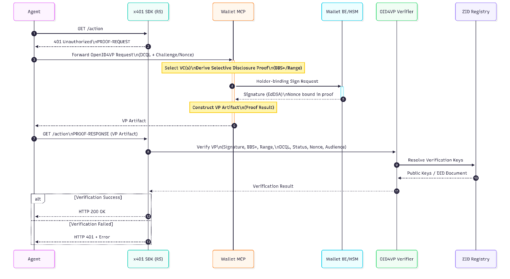

# Baseline flow (identity only)

<figure><figcaption>
x401 baseline flow: identity only
</figcaption></figure>

* **Request.** Agent requests a protected resource with no proof.
* **Challenge.** The X401 SDK returns 401 Unauthorized (`Cache-Control: no-store`) with the challenge carrying the credential requirement, including a verifier challenge/nonce.
* **Presentation acquisition.** The agent forwards the embedded OpenID4VP request (JAR), DCQL and challenge intact, to the Agentic Wallet MCP. The MCP selects credentials, **delegates SD proof derivation to the MBI RS** (`/v1/vp/ext/*`; the MCP is a thin wallet with no BBS+/Bulletproof libraries), and requests a **holder-binding signature from the HSM via the Wallet BE** (the one private-key operation). *(Verifier-nonce binding into the holder proof is **pending** — a server-random nonce is used today; see [Open items & decisions](../open-items-and-decisions.md).)*
* **Retry.** Agent submits the proof artifact to `POST /v1/presentation/submit`.
* **Verify & respond.** The OID4VP Verifier validates **in-process**, signature, BBS+, range-proof, DCQL, status, nonce/audience, resolving issuer keys from the on-chain ZID Registry. Result delivery is **sync-HMAC** (inline) or **callback**.
